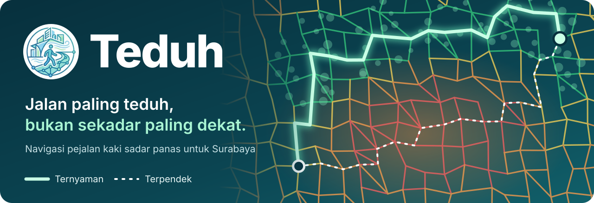
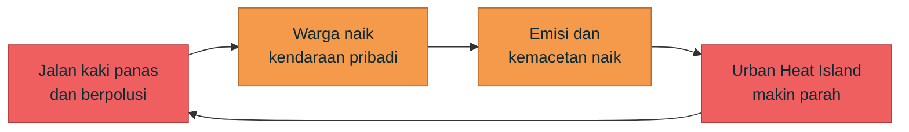
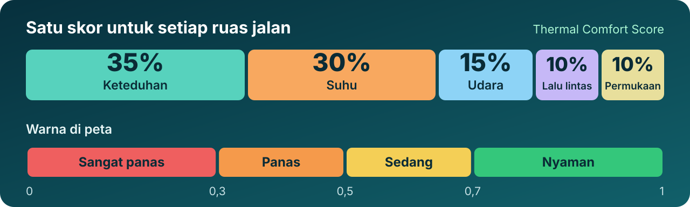
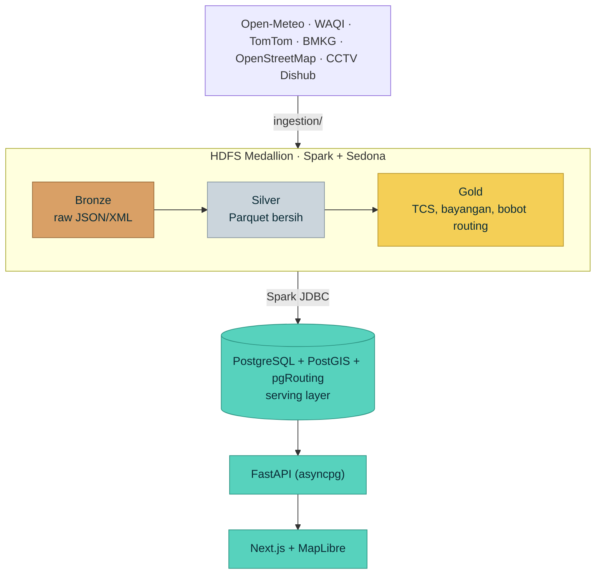

<p align="center">
  <a href="https://teduh-app.vercel.app">
    
  </a>
</p>

<p align="center">
  <a href="https://teduh-app.vercel.app"></a>
</p>

<p align="center">
  
  
  
</p>

<p align="center">
  <a href="#-masalahnya">Masalahnya</a> &nbsp;·&nbsp;
  <a href="#-solusinya">Solusinya</a> &nbsp;·&nbsp;
  <a href="#-cara-kerjanya">Cara Kerjanya</a> &nbsp;·&nbsp;
  <a href="#-tech-stack">Tech Stack</a> &nbsp;·&nbsp;
  <a href="#-menjalankan-secara-lokal">Jalankan Lokal</a> &nbsp;·&nbsp;
  <a href="#-tim">Tim</a>
</p>

<br>

<table>
<tr>
<td valign="middle">

Teduh menghitung seberapa nyaman setiap ruas jalan di Surabaya untuk dilalui dengan berjalan kaki (keteduhan, suhu, kualitas udara, lalu lintas, dan kondisi trotoar), lalu memakai nilai itu untuk mencari rute. Data yang sama disajikan ke pemerintah kota sebagai dasar menentukan di mana pohon harus ditanam lebih dulu.

</td>
<td align="center" valign="middle" width="150">
<a href="https://teduh-app.vercel.app"></a><br>
<sub>Pindai untuk membuka di ponsel</sub>
</td>
</tr>
</table>

---

## 🔥 Masalahnya

> **Berjalan kaki di Surabaya itu panas, berpolusi, dan tidak nyaman, jadi orang memilih naik kendaraan bahkan untuk jarak dekat.**

| Fakta | Angka |
|---|---|
| 🌡️ Suhu udara siang saat kemarau | **35–37 °C**, terasa hingga **41 °C** (BMKG Juanda, 2024) |
| 🏙️ Selisih suhu permukaan CBD vs pinggiran kota (Urban Heat Island) | **6–8 °C** lebih panas |
| 📈 Peringkat suhu permukaan | Surabaya masuk **20% kota terpanas** di Indonesia |
| 😷 Kualitas udara, 2 Juli 2026 | **AQI 193 (Tidak Sehat)**, terburuk se-Indonesia (IQAir) |
| 🌳 Area hijau yang hilang | **1.190 ha** (citra Sentinel-2) · RTH baru **21,99%** |
| 🚧 Trotoar layak | **~220 km** dari ~1.400 km jaringan jalan |
| 👟 Rata-rata langkah harian orang Indonesia | **3.513 langkah/hari**, salah satu yang terendah di dunia |
| 🚌 Penumpang Suroboyo Bus | **~4.700/hari**, load factor di bawah 50% |

Polanya membentuk lingkaran setan:



Aplikasi navigasi yang ada (Google Maps, Waze) tidak membantu memutus lingkaran ini. Mereka hanya mengoptimalkan jarak dan waktu, sehingga pejalan kaki sering diarahkan lewat jalan yang paling gersang. Masalah yang sama juga menghambat transportasi umum: perjalanan dari rumah ke halte (*first mile* dan *last mile*) terasa tidak nyaman, padahal ketidaknyamanan termal terbukti menurunkan minat orang untuk berjalan ke titik transit.

Di sisi pemerintah, kondisi iklim mikro kota hanya dipantau lewat survei lapangan berkala. Akibatnya sulit menentukan koridor mana yang paling mendesak untuk dihijaukan.

---

## 🌿 Solusinya

Teduh melayani dua pihak dengan data yang sama:

<table>
<tr>
<th width="50%">🚶 Untuk warga: navigasi yang sadar panas</th>
<th width="50%">🏛️ Untuk pemerintah kota: dashboard pendukung keputusan</th>
</tr>
<tr>
<td valign="top">

- **Dua rute sekaligus.** Rute *terpendek* dibandingkan dengan rute *ternyaman*, lengkap dengan jarak, durasi, lama terpapar matahari, dan skor kenyamanan rata-rata.
- **Personal Heat Budget.** Pengguna memilih toleransi panasnya (rendah, sedang, atau tinggi), dan rute menyesuaikan. Kalau tidak ada rute yang memenuhi batas tersebut, Teduh tetap memberi rute terbaik yang ada, disertai peringatan.
- **Peta kenyamanan termal sekota.** Semua ruas jalan diwarnai dari 🟢 nyaman sampai 🔴 sangat panas.
- **Live CCTV Dishub.** Pengguna bisa melihat kondisi jalan secara real-time di sekitar rute.

</td>
<td valign="top">

- **Koridor prioritas penghijauan.** Ruas dengan kenyamanan terendah diurutkan sebagai prioritas.
- **Walkability & akses transit.** Seberapa nyaman jalur menuju halte.
- **Simulasi kebijakan berbasis ML.** "Bagaimana kalau ditanam pohon?" atau "Bagaimana kalau aspal diganti *cool pavement*?" Model memprediksi dampaknya terhadap kenyamanan per ruas dan per jam.

</td>
</tr>
</table>

**Contoh nyata dari API produksi** (dua titik di pusat Surabaya, toleransi sedang):

| Rute | Jarak | Durasi | Terpapar matahari | Skor kenyamanan |
|---|---|---|---|---|
| Terpendek | 3,57 km | 47,6 menit | 1,9 menit | 0,683 |
| 🌿 **Ternyaman** | **3,59 km** | **47,9 menit** | **0 menit** | **0,694** |

> [!TIP]
> Rute ternyaman hanya 20 meter lebih jauh, tetapi pengguna sama sekali tidak terpapar matahari langsung.

### Teduh vs aplikasi navigasi umum

| Fitur | Google Maps / Waze | Teduh |
|---|:---:|:---:|
| Rute terpendek | ✅ | ✅ |
| Skor kenyamanan termal per ruas jalan | ❌ | ✅ |
| Kualitas udara dalam pemilihan rute | ❌ | ✅ |
| Rute yang menyesuaikan toleransi panas pengguna | ❌ | ✅ |
| Dashboard dan simulasi kebijakan untuk pemerintah kota | ❌ | ✅ |

---

## 🔧 Cara Kerjanya

### Thermal Comfort Score (TCS)

Setiap ruas jalan (58.135 ruas di Surabaya) diberi skor 0–1. Semakin tinggi skornya, semakin nyaman ruas itu untuk berjalan kaki.

<p align="center">
  
</p>

$$\text{TCS} = 0.35 \cdot \text{shade} + 0.30 \cdot \text{temp} + 0.15 \cdot \text{aqi} + 0.10 \cdot \text{traffic} + 0.10 \cdot \text{surface}$$

| Komponen | Bobot | Cara menghitung |
|---|:---:|---|
| 🌳 **Keteduhan** (`shade`) | 35% | `0.7 × rasio bayangan + 0.3 × kerapatan pohon`. Bayangan gedung dan pohon diproyeksikan dari posisi matahari di Surabaya setiap jam. Kerapatan pohon dihitung dari pohon OSM dalam radius 30 m. |
| 🌡️ **Suhu** (`temp`) | 30% | `1 − (T − 28) / (45 − 28)`, dengan `T = 0.6 × suhu terasa + 0.4 × suhu permukaan`. Suhu permukaan = suhu udara + koreksi material (aspal +8 °C, beton +6 °C, paving +4 °C, rumput −2 °C). |
| 💨 **Kualitas udara** (`aqi`) | 15% | `1 − AQI / 150`, dibatasi ke 0–1. Skor jatuh ke 0 saat AQI di atas 150. |
| 🚗 **Lalu lintas** (`traffic`) | 10% | Rasio kemacetan real-time dari TomTom. |
| 🧱 **Permukaan** (`surface`) | 10% | Material dan kerataan trotoar dari OSM. |

### Routing

Routing memakai pgRouting (`pgr_dijkstra`) pada graf jalan yang sudah di-*node* (58.135 edge, 27.663 vertex).

- **Rute terpendek:** `cost = panjang / 1,33 m/s` (waktu tempuh berjalan normal).
- **Rute ternyaman:** setiap ruas yang panas diberi penalti:

$$\text{cost} = \frac{\text{panjang}}{1{,}33} \times \left(1 + m \cdot (1 - \text{TCS})^2 \cdot 5\right)$$

Penalti dikuadratkan dan dikali 5 karena sebaran TCS di lapangan sempit. Tanpa penguatan ini, Dijkstra hampir selalu memilih jalan yang sama dengan rute terpendek.

| Toleransi panas | Pengali `m` | Batas paparan matahari |
|---|:---:|:---:|
| Rendah | 5,0 | 8 menit |
| Sedang | 3,0 | 15 menit |
| Tinggi | 0,8 | 25 menit |

> [!NOTE]
> Jika rute ternyaman tetap melebihi batas paparan, API mengembalikan `"within_heat_budget": false` dan frontend menampilkan peringatan. Rute tetap digambar di peta.

### Simulasi kebijakan (Machine Learning)

`LinearRegression` (Spark MLlib) dilatih untuk memprediksi TCS dari kerapatan vegetasi, suhu permukaan, keteduhan, kemacetan, AQI, dan kualitas permukaan jalan. Model lalu dipakai untuk dua skenario "what-if" di seluruh ruas jalan:

- 🌿 **Penghijauan:** kerapatan vegetasi +0,25 (maksimal 0,72).
- ❄️ **Cool pavement:** suhu permukaan −3,5 °C.

Hasilnya, yaitu kenaikan TCS per ruas, kurva per jam, dan 50 zona terpanas, ditampilkan di tab **Simulasi Panas** pada dashboard.

### Arsitektur data



1. **Bronze:** data mentah cuaca, AQI, lalu lintas, dan peringatan BMKG disimpan apa adanya di HDFS.
2. **Silver:** Spark membersihkan dan menyeragamkan skema, menginterpolasi data secara spasial, lalu menyimpannya sebagai Parquet terpartisi.
3. **Gold:** Spark (dengan Sedona untuk operasi geospasial) menghitung proyeksi bayangan 3D, proxy NDVI/LST, TCS, bobot routing, dan simulasi ML.
4. **Serving:** hasil Gold dimuat ke PostGIS/pgRouting supaya query rute bisa selesai dalam hitungan detik.

### Sumber data

Semua sumber data bersifat terbuka atau memiliki kuota gratis.

| Data | Sumber |
|---|---|
| Cuaca per jam (suhu, suhu terasa, kelembapan, angin) | Open-Meteo |
| Jaringan jalan, trotoar, bangunan, pohon | OpenStreetMap (Overpass API) |
| Kualitas udara | WAQI (aqicn.org) |
| Kemacetan | TomTom Traffic |
| Peringatan cuaca | BMKG (RSS) |
| Kamera lalu lintas | CCTV Dishub Surabaya (HLS) |
| Halte transit | Halte Suroboyo Bus, Trans Semanggi, dan stasiun KAI (OSM + data publik) |

---

## 🧰 Tech Stack

| Layer | Teknologi |
|---|---|
| **Frontend** |      |
| **Backend** |   |
| **Database** |    |
| **Pemrosesan** |    |
| **Produksi** |    |

Peta memakai basemap OpenFreeMap dan frontend memakai Next.js App Router.

---

## 🚀 Menjalankan Secara Lokal

**Butuh:** Docker + Docker Compose, Node.js 18+.

```bash
# 1. Environment: isi TOMTOM_API_KEY dan WAQI_API_TOKEN
cp .env.example .env

# 2. Database dan API
docker compose up -d --build postgres api

# 3. Pipeline lengkap (HDFS + Spark), tunggu sampai selesai
docker compose --profile pipeline up spark-pipeline

# 4. Frontend
cd frontend && npm install && npm run dev   # buka http://localhost:3000
```

> [!NOTE]
> Run pertama memakan waktu sekitar **10–15 menit**: pipeline mengunduh jaringan jalan Surabaya dari OpenStreetMap, membangun topologi routing, lalu menghitung TCS. Data disimpan di volume `pgdata`, jadi untuk run berikutnya cukup `docker compose up -d`.

> [!IMPORTANT]
> Teduh tidak pernah mengisi data palsu. Kalau suatu input tidak tersedia dari API maupun dari pembacaan nyata terakhir, langkah yang membutuhkannya dilewati dan data yang sudah ada tidak diubah.

Cek bahwa data sudah masuk:

```bash
docker exec teduh_db psql -U cc_user -d commute_cool -c "SELECT COUNT(*) FROM thermal_comfort_scores;"
curl -X POST http://localhost:8000/api/route -H "Content-Type: application/json" \
  -d '{"origin":{"lat":-7.27,"lng":112.75},"destination":{"lat":-7.26,"lng":112.74}}'
```

Untuk menjalankan ulang hanya bagian Spark (tanpa mengunduh data lagi), pakai `docker compose run --rm spark-pipeline -m spark_jobs.run_pipeline --skip-ingest`.

### Testing

```bash
pip install -r requirements.txt
python -m pytest tests/ -v
```

---

## ☁️ Deployment

Versi online berjalan sepenuhnya di free tier:

| Layer | Layanan |
|---|---|
| Frontend | Vercel Hobby |
| API | AWS Lambda + Function URL (AWS SAM) |
| Database | Supabase Free (PostGIS + pgRouting) |
| Pipeline | Docker Compose lokal, lalu hasilnya di-snapshot ke Supabase |

Panduan lengkapnya ada di **[docs/DEPLOYMENT.md](docs/DEPLOYMENT.md)**.

---

## 🗂️ Struktur Project

<details>
<summary><b>Lihat struktur folder</b></summary>

```
teduh/
|-- AGENTS.md                 Peta kode & aturan data (mulai dari sini)
|-- api/                      FastAPI backend (juga dikemas untuk AWS Lambda)
|   |-- routes/               navigation (pgRouting), dashboard, cctv, reports, alerts
|   |-- conditions.py         Kondisi termal per jam
|   |-- models/schemas.py     Pydantic models
|   |-- db.py                 asyncpg connection pool
|   +-- lambda_handler.py     Entry point Lambda (Mangum)
|-- ingestion/                Pengambilan data API, OSM, CCTV, fast refresh, scheduler
|-- spark_jobs/               Pipeline Spark + Sedona (raster, bayangan, TCS, lalu lintas, bobot graf, ML)
|   +-- run_pipeline.py       Orkestrator pipeline lengkap
|-- frontend/                 Next.js: dashboard (/) dan navigasi (/navigasi)
|-- database/                 Skema, fungsi topologi pgRouting, seed halte
|-- docker/                   Dockerfile dan konfigurasi Hadoop
|-- validation/               Validasi model bayangan & termal
|-- tests/                    Unit & e2e tests
|-- notebooks/                Notebook eksplorasi pipeline & ML
|-- scripts/sync_to_supabase.sh   Snapshot database lokal ke Supabase
|-- docs/                     DEPLOYMENT, DEMO_GUIDE, specs/
|-- docker-compose.yml        postgres, hadoop (namenode/datanode), spark-pipeline, api
+-- template.yaml, samconfig.toml   Konfigurasi AWS SAM
```

</details>

---

## 🛣️ Rencana Pengembangan

Fitur di atas sudah berjalan. Modul berikut adalah rancangan untuk tahap berikutnya:

- 🚌 **Teduh-Transit:** perencana perjalanan multimodal yang menggabungkan jalan kaki ber-TCS tinggi ke halte dengan jadwal GTFS Suroboyo Bus dan Feeder Wira Wiri (OpenTripPlanner), dilengkapi perbandingan biaya dan emisi CO₂ terhadap mobil atau motor.
- 👁️ **Teduh-Eye:** pelaporan kerusakan trotoar dari foto warga. Foto dianalisis dengan YOLOv8 + CLIP, lalu divalidasi oleh AI, petugas Dishub, dan konfirmasi warga sekitar.
- 🧠 **Teduh-Brain:** mesin rekomendasi "jalan kaki atau naik transit?" yang belajar dari keputusan pengguna, plus notifikasi pagi tentang jam paling nyaman untuk berangkat.
- 📱 **Aplikasi mobile** (Android & iOS), integrasi sensor IoT suhu dan kualitas udara, serta ekspansi ke kota tropis lain di Indonesia.

---

## 📚 Referensi

<details>
<summary><b>Lihat 15 referensi</b></summary>

- Althoff, T. et al. (2017). Large-scale physical activity data reveal worldwide activity inequality. *Nature*, 547, 336–339.
- BMKG (2024). Cuaca di kota semakin panas, BMKG ajak generasi muda mitigasi urban heat island. *Siaran pers BMKG*, 28 Juni.
- Buo, I. et al. (2026). Cool routes: Real-time human thermal exposure routing. *Building and Environment*, 298. https://doi.org/10.1016/j.buildenv.2026.114622
- Dang, A., Yamaguchi, H. & Higashino, T. (2012). NaviComf: Navigate pedestrians for comfort using multi-modal environmental sensors. *IEEE PerCom 2012*, 76–84. https://doi.org/10.1109/PerCom.2012.6199852
- Fathoni, S. & Handayeni, K.D.M.E. (2022). Pola spasial tingkat aksesibilitas Suroboyo Bus dengan metode PTAL di Kota Surabaya. *Jurnal Teknik ITS*, 11(2), E115–E122. https://doi.org/10.12962/j23373539.v11i2.97645
- Ignatius, M., Wong, N.H. & Jusuf, S.K. (2024). Urban digital twins for pedestrian thermal comfort evaluation. *Building and Environment*, 248, 111098. https://doi.org/10.1016/j.buildenv.2023.111098
- Jatayu, A. & Susetyo, C. (2017). Analisis perubahan temperatur permukaan wilayah Surabaya Timur tahun 2001–2016 menggunakan citra LANDSAT. *Jurnal Teknik ITS*, 6(2), C429–C433.
- Katadata (2026). Daftar wilayah RI dengan polusi udara terburuk pagi ini, Surabaya teratas. *Katadata.co.id*, diakses 3 Juli 2026.
- Khairurrijal, M.H. et al. (2025). Pembuatan peta suhu permukaan tanah untuk mitigasi urban heat island dengan visualisasi augmented reality (studi kasus: Kota Surabaya). *Sewagati*, 4(2), 10–22.
- Ma, X. et al. (2025). Active route choice to minimize pedestrian thermal discomfort in a high-density subtropical city. *Sustainable Cities and Society*, 131. https://doi.org/10.1016/j.scs.2025.106697
- Melnikov, V.R. et al. (2022). Behavioural thermal regulation explains pedestrian path choices in hot urban environments. *Scientific Reports*, 12(1). https://doi.org/10.1038/s41598-022-06383-5
- Santamouris, M. (2020). Recent progress in cool phytotechnologies and pavement cooling to mitigate urban heat island. *Solar Energy*, 200.
- Sopilawati, R. et al. (2025). Analisis indeks kelayakan berjalan (walkability index) pada fasilitas pejalan kaki. *Briliant: Jurnal Riset dan Konseptual*, 10(4), 1049–1059.
- TomTom International BV (2024). *TomTom Traffic Index 2024: Surabaya*.
- Zardo, F. et al. (2021). Shading paths: A spatial optimization model to minimize pedestrian heat stress along walking routes in hot cities. *Landscape and Urban Planning*, 214.

</details>

---

## 👥 Tim

<p align="center">
  <b>Rayka Dharma Pranandita</b> &nbsp;·&nbsp; <b>Evan Christian Nainggolan</b> &nbsp;·&nbsp; <b>Naufal Ardhana</b>
</p>
